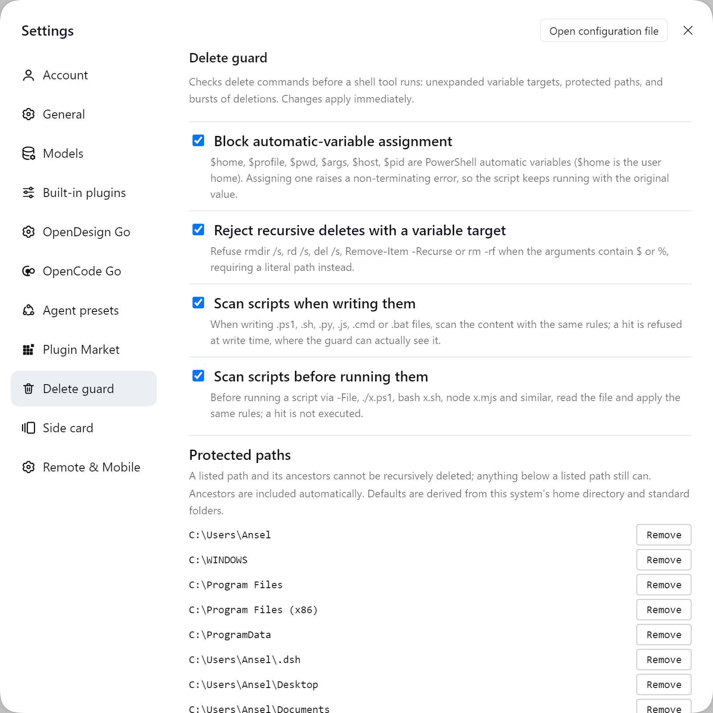

# @voltarenyah/dsh-delete-guard

**English** | [简体中文](./README.zh-CN.md)

A delete guard for [DeepSeek Harness](https://github.com/deepseek-ai/deepseek-harness). It inspects every
shell command at the host's `tools/pre-execute` seam and refuses the ones that would delete something
you cannot get back. It also keeps a local audit log of recursive deletes and blocked calls, so a
mis-delete can be reconstructed afterwards.

Policy layer, not a sandbox: it decides *whether a command runs*, it does not intercept filesystem calls.



> The screenshots show the top of the page; the "Delete audit log" and "Windows shadow copies" cards
> sit below the rate-limit section.

## What it blocks

| Rule | Trigger | Result |
|---|---|---|
| **Automatic-variable assignment** | A command assigns to `$home`, `$profile`, `$pwd`, `$input`, `$args`, `$host`, `$pid`, `$error`, `$matches`, `$pshome`, `$PSScriptRoot`, `$LASTEXITCODE`, … | Denied |
| **Variable delete target** | A recursive delete (`rmdir /s`, `rd /s`, `del /s`, `Remove-Item -Recurse`, `rm -rf`) whose argument region contains `$` or `%` | Denied |
| **Protected path** | A recursive delete targets a listed path, or an ancestor of one | Denied |
| **Script body at write time** | Writing a `.ps1`, `.sh`, `.py`, `.js`, `.cmd`, `.bat` file whose content hits any rule above | Denied |
| **Script body before it runs** | Executing a script through `-File`, `./x.ps1`, `bash x.sh`, `node x.mjs` while its content hits any rule above | Denied |
| **Delete rate limit** | More delete commands inside the window than the threshold | Denied |
| **Audit-directory self-protection** | Deleting the audit log directory, an ancestor of it, or a file inside it | Denied |

Besides blocking, the plugin writes recursive deletes (allowed and blocked) and every blocked call to
a local audit log under `$DSH_HOME/delete-guard/audit` by default.

Why the first rule matters: PowerShell variable names are case-insensitive, so `$home` **is** `$HOME`.
Assigning to it is a *non-terminating* error, the script keeps running, and every later use of `$home`
still resolves to the user's home directory. A command that looks like "delete a temp folder" can
therefore delete the profile.

The path rule uses scope proof rather than a keyword blocklist:

- A listed path and its **ancestors** are protected — deleting an ancestor would take the listed path with it.
- Anything **below** a listed path is still deletable, so build output and scratch directories keep working.
- Deleting a path that is not covered does not need an allowlist entry.

Scripts are covered in both directions, because a delete hidden in a `.ps1` never appears on the
command line:

- **At write time** the `write`/`edit` tools carry the whole file body, so the same rules run over it.
- **Before execution** a command such as `pwsh -File x.ps1`, `./x.ps1`, `bash x.sh` or `node x.mjs`
  makes the guard read that file first and apply the same rules.

Both directions use one shared `evaluate()`, so a line that is refused on the command line is refused
inside a script too — there is no second rule set to drift.

## Install

```shell
dsh plugin --profile <profile> add @voltarenyah/dsh-delete-guard
```

The plugin is host + web client: after installing, restart DSH, then open
**Settings → Delete guard**.

## Settings

Everything is editable from **Settings → Delete guard** and takes effect on the next tool call
(no restart): the switches, the protected-path list, the rate-limit threshold/window, and the audit
log switch and retention.

| Key | Default | Meaning |
|---|---|---|
| `blockAutoVarAssignment` | `true` | Deny assignments to PowerShell automatic variables |
| `blockVariableDelete` | `true` | Deny recursive deletes whose arguments contain `$` or `%` |
| `scanScriptWrites` | `true` | Scan script content when a file is written through the `write`/`edit` tools |
| `scanScriptExec` | `true` | Read the file and scan it before a script runs |
| `protectedPaths` | platform-derived (see below) | Paths that cannot be recursively deleted; each entry carries an `enabled` switch |
| `maxDeletesPerWindow` | `20` | Delete commands allowed per window; `0` disables the limit |
| `windowSeconds` | `60` | Rate-limit window |
| `auditLog` | `true` | Write recursive deletes and blocked calls to the audit log |
| `auditRetentionDays` | `30` | Days to keep audit logs; `0` keeps them forever |
| `auditDir` | `$DSH_HOME/delete-guard/audit` | Audit log directory; normally no need to change |

## When a call is blocked

The refusal is returned in **both English and Chinese**, whatever the UI language, and it ends with
what to do next:

```
dsh-delete-guard blocked this call.
Assigning to the PowerShell automatic variable $home = is not allowed. …
dsh-delete-guard 已拦截本次调用。
不能给 PowerShell 自动变量赋值（$home =）。…

To proceed: use a literal path and confirm it first …
要继续：改用字面路径并先打印确认 …
```

Two ways forward, and the message names both:

1. **Change the command** — resolve the target to a literal path and print it first
   (`Resolve-Path` + `Write-Output`), or point the delete at a concrete subdirectory instead of a
   protected root. Both of these are things an agent follows from the instructions alone, so they are
   not "allowed" — they are simply written correctly.
2. **Switch that path off** — for a protected path, open Settings → Delete guard and clear the
   checkbox in front of that entry (or remove it), then retry. Approval is per entry on purpose: there
   is no "allow everything" button, and the refusal lists **every** entry that stands in the way, so
   disabling one obviously does not blanket-approve the rest.


The system prompt tells the agent the same thing: rewrite the variable rules with a literal path; for a
protected path, explain it and ask you to switch that single entry off — never work around the check
with quoting tricks, string splitting or base64.

The same values live in the profile's `cordis.patch.yml`:

```yaml
- id: dsh-delete-guard
  name: '@voltarenyah/dsh-delete-guard'
  config:
    blockAutoVarAssignment: true
    blockVariableDelete: true
    protectedPaths:
      - C:\Users\me
      - D:\Projects\keep
    maxDeletesPerWindow: 20
    windowSeconds: 60
    auditLog: true
    auditRetentionDays: 30
```

## Delete audit log

Enabled by default. Logs live under `$DSH_HOME/delete-guard/audit` (on Windows usually
`C:\Users\<name>\.dsh\delete-guard\audit`), one JSONL file per day.

Recorded by default:

- **recursive deletes**, both allowed and blocked;
- **every blocked call** (automatic variable, variable target, protected path, rate limit, script
  scan, audit-directory self-protection);
- when an executed script contains a recursive delete, an extra `script-exec` record.

Ordinary allowed non-recursive deletes are not recorded, so the log is not flooded by single-file
cleanups.

Each `delete-intent` record carries:

| Field | Meaning |
|---|---|
| `ts` / `tz` | UTC timestamp and local zone |
| `tool` / `callId` / `sessionId` | tool, call, and session |
| `cwd` | session working directory |
| `command` | original command (truncated at 8 KiB; `truncated` marks it) |
| `targets` | literal target paths parsed from the command |
| `recursive` / `verdict` / `rule` | recursive or not, allowed or blocked, which rule (R1–R7) |
| `blockers` | every protected entry that stood in the way |
| `severity` | `critical` (variables/protected path/self-protection) or `high` (rate limit/script/allowed recursive) |

An allowed recursive delete also gets a `delete-result` record with `isError`, `errorCode`, and
`durationMs`.

To investigate a mis-delete, open the day's file and filter:

```powershell
$dir = "$env:USERPROFILE\.dsh\delete-guard\audit"
Get-ChildItem -LiteralPath $dir -Filter 'audit-*.jsonl' |
  Sort-Object LastWriteTime -Descending |
  Select-Object -First 1 |
  Get-Content |
  Select-String '"verdict":"blocked"'
```

If `DSH_HOME` is overridden, replace `$dir` with the real path. The audit directory is
self-protected: deleting files inside it is refused by rule R7. R7 is built in and has no switch in
Settings.

Limits:

- The log records **calls**, not file contents. It tells you who ran what against which path; it does
  not tell you which files were inside a deleted directory.
- The log is not a tamper-proof ledger; an agent with file permissions may still modify it. R7 only
  blocks tool-level deletes.
- Commands may contain tokens or passwords. The directory is private to the current user, and the
  default retention is 30 days.
- A failed audit write never changes the guard's decision; it only logs a warning.

## Windows shadow copies

Reading Windows shadow-copy times requires **administrator** privileges. DSH runs as a normal user,
so `vssadmin`, `wbadmin`, and `Get-ComputerRestorePoint` are denied. The settings page therefore shows
the query method instead of elevating.

Run this in an elevated PowerShell:

```powershell
vssadmin list shadows
```

Or:

```powershell
Get-CimInstance Win32_ShadowCopy |
  Sort-Object InstallDate -Descending |
  Select-Object InstallDate, VolumeName
```

The newest `InstallDate` is the closest thing to "when was the last snapshot".

Caveats:

- A shadow copy is **not a full backup**. System Restore points mainly cover system files and the
  registry, not necessarily user files.
- Shadow copies are per volume; the system and data volumes can differ.
- Old copies are deleted when shadow storage fills up; the newest copy may not contain the file you
  just deleted.
- Do not run the whole DSH as administrator just to read the timestamp.

## Default protected paths

The defaults are computed at load time from `os.homedir()` and the platform's environment — no
machine-specific paths are hardcoded:

| | Windows | macOS | Linux |
|---|---|---|---|
| Home | `C:\Users\<name>` | `/Users/<name>` | `/home/<name>` |
| System | `SystemRoot`, `Program Files`, `Program Files (x86)`, `ProgramData` | `/Applications`, `/System`, `/Library`, `/usr`, `/bin`, `/sbin`, `/etc` | `/etc`, `/usr`, `/bin`, `/sbin`, `/lib`, `/boot` |
| DSH home | `~\.dsh` | `~/.dsh` | `~/.dsh` |
| Standard folders | Desktop, Documents, Downloads, Pictures, Videos, Music, OneDrive | Desktop, Documents, Downloads, Pictures, Movies, Music | same as Windows |

Because ancestors are protected automatically, the list does not repeat them: listing `C:\Users\me`
already protects `C:\Users` and `C:\`. Adding an entry that is already covered is rejected with an
explanatory message.

Behaviour when a path is unusable:

| Situation | Behaviour |
|---|---|
| Entry is not an absolute path for this platform (e.g. `/Users/x` on Windows, or `Documents`) | Ignored |
| Entries configured but none valid for this platform | Falls back to the defaults (fails closed) and logs a warning |
| List explicitly emptied | No path protection — this is the user's stated intent, and the UI says so |
| Path does not exist right now (unplugged drive) | Kept; protection applies when it appears |

The default list is generated once and then stored as an explicit list as soon as you edit it in
Settings. To return to "computed from this machine", delete that `- id: dsh-delete-guard` block from
`cordis.patch.yml`.

## Known limits

| Not covered | Why |
|---|---|
| Deletes assembled at run time (base64, `Add-Type` C#, string concatenation, `[IO.File]::Delete`) | Only static text is scanned; the guard does not execute code to find out |
| Command names assembled in a variable and invoked (`& $cmd`) | Not resolvable from text |
| Commands split across several inputs in a persistent terminal | Each call sees only its own text |
| `robocopy /MIR`, `git clean -fdx` and other non-delete verbs | Outside the delete-verb set |
| Anything that happens after a call is allowed | This plugin does not intercept filesystem calls and has no trash |
| The audit log records calls, not file contents | It tells you who ran what against which path; recovery still needs a snapshot/backup |
| The audit log is not a tamper-proof ledger | An agent with file permissions may still modify it; R7 only blocks tool-level deletes |
| Shadow-copy times require administrator rights | The plugin does not self-elevate; the settings page only shows the command |

The rate limit counts **tool calls**, not files: one command deleting 100 000 files counts once.

The audit log is for reconstruction, not recovery. If you need "deleted but recoverable", pair this
with volume snapshots/backups, or use a recycle-bin plugin such as `dsh-safe-delete` or
`dsh-delete-guard` — this plugin focuses on never starting the delete.

## License

MIT
