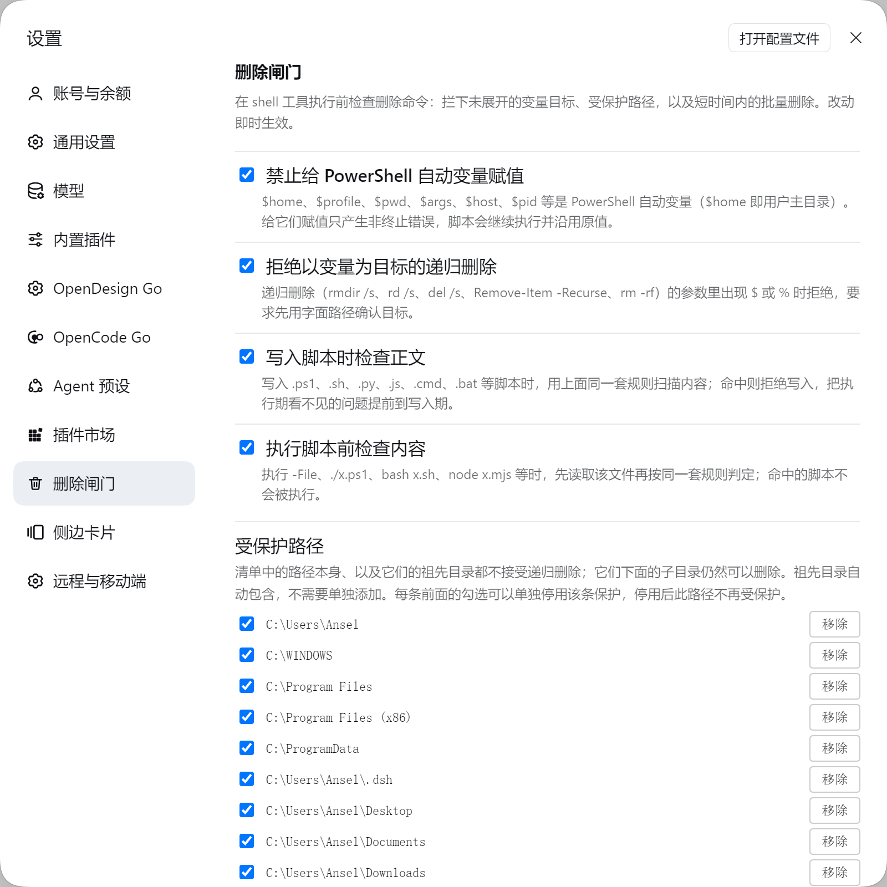
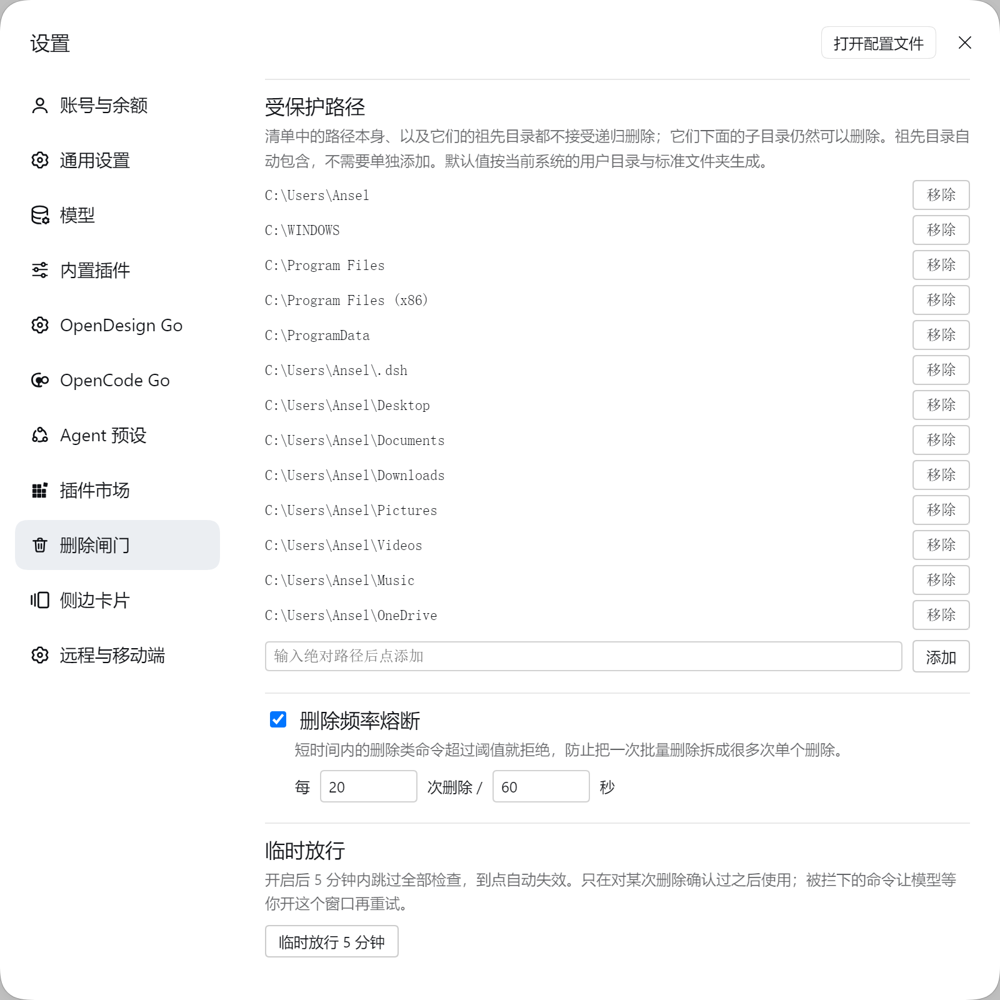

# @voltarenyah/dsh-delete-guard

[English](./README.md) | **简体中文**

面向 [DeepSeek Harness](https://github.com/deepseek-ai/deepseek-harness) 的删除闸门。它在宿主的
`tools/pre-execute` 接缝上检查每一条 shell 命令，拒绝那些"删了就找不回来"的操作。

策略层，不是沙箱：它决定**一条命令能不能跑**，不接管文件系统调用。



## 拦什么

| 规则 | 触发条件 | 结果 |
|---|---|---|
| **自动变量赋值** | 命令给 `$home` `$profile` `$pwd` `$input` `$args` `$host` `$pid` `$error` `$matches` `$pshome` `$PSScriptRoot` `$LASTEXITCODE` 等赋值 | 拒绝 |
| **变量删除目标** | 递归删除（`rmdir /s`、`rd /s`、`del /s`、`Remove-Item -Recurse`、`rm -rf`）的参数区出现 `$` 或 `%` | 拒绝 |
| **受保护路径** | 递归删除的目标是清单中的路径，或清单中某个路径的祖先 | 拒绝 |
| **写入脚本时扫正文** | 写 `.ps1`、`.sh`、`.py`、`.js`、`.cmd`、`.bat` 时，正文命中上面任一规则 | 拒绝写入 |
| **执行脚本前扫正文** | 通过 `-File`、`./x.ps1`、`bash x.sh`、`node x.mjs` 执行脚本，内容命中上面任一规则 | 拒绝执行 |
| **删除频率熔断** | 窗口内的删除类命令超过阈值 | 拒绝 |

第一条为什么必要：PowerShell 变量名大小写不敏感，`$home` **就是** `$HOME`。给它赋值是**非终止错误**，
脚本继续执行，之后每一次 `$home` 仍然指向用户主目录。一条看起来"删临时目录"的命令，可能删掉整个用户目录。

路径规则按"作用域证明"设计，不是关键词黑名单：

- 清单中的路径及其**祖先**受保护——删祖先会连带删掉清单项；
- 清单路径**下面**的子目录照常可删，构建产物、临时目录不受影响；
- 未被覆盖的路径不需要额外加白名单。

脚本两个方向都覆盖——藏在 `.ps1` 里的删除不会出现在命令行上：

- **写入时**：`write`/`edit` 工具的参数里就有完整正文，同一套规则直接跑一遍；
- **执行前**：命令里出现 `pwsh -File x.ps1`、`./x.ps1`、`bash x.sh`、`node x.mjs` 时，
  守卫先读这个文件，再按同一套规则判定。

两个方向共用同一个 `evaluate()`，所以"命令行里被拒的写法"在脚本里也一定被拒，不存在两套规则漂移。

## 安装

```shell
dsh plugin --profile <profile> add @voltarenyah/dsh-delete-guard
```

插件含宿主与 Web 客户端两部分：安装后重启 DSH，打开 **设置 → 删除闸门**。

## 设置

全部在 **设置 → 删除闸门** 里改，下一次工具调用即生效（无需重启）：两个开关、受保护路径清单、
熔断阈值与窗口。

| 配置项 | 默认 | 含义 |
|---|---|---|
| `blockAutoVarAssignment` | `true` | 拒绝给 PowerShell 自动变量赋值 |
| `blockVariableDelete` | `true` | 递归删除参数里出现 `$` 或 `%` 时拒绝 |
| `scanScriptWrites` | `true` | 通过 `write`/`edit` 写脚本文件时扫描正文 |
| `scanScriptExec` | `true` | 执行脚本前读取文件内容再判定 |
| `protectedPaths` | 按平台生成（见下） | 不接受递归删除的路径清单 |
| `maxDeletesPerWindow` | `20` | 窗口内允许的删除命令数，`0` 关闭 |
| `windowSeconds` | `60` | 熔断窗口（秒） |
| `allowUntil` | `0` | 临时放行的截止时间（毫秒时间戳），由「临时放行 5 分钟」写入 |

## 被拦截时

拒绝信息**中英双语**返回，与界面语言无关，末尾直接给出下一步：

```
dsh-delete-guard blocked this call.
Assigning to the PowerShell automatic variable $home = is not allowed. …
dsh-delete-guard 已拦截本次调用。
不能给 PowerShell 自动变量赋值（$home =）。…

To proceed: …
要继续：改用字面路径并先打印确认 …
```

两条出路，文案里都写了：

1. **改命令**——把目标解析成字面路径并先打印（`Resolve-Path` + `Write-Output`），或者把删除指向
   具体子目录，而不是受保护的那个根。
2. **开一个 5 分钟窗口**——设置 → 删除闸门 →「临时放行 5 分钟」。到期前跳过全部检查，面板上有
   实时倒计时，宿主会为每次被放行的调用打一条日志，事后查得到。



系统提示词里也写了同样的规则：被拦时先解释原因、请你开窗口，而不是换个写法硬闯。

同一份配置也写在 profile 的 `cordis.patch.yml`：

```yaml
- id: dsh-delete-guard
  name: '@voltarenyah/dsh-delete-guard'
  config:
    blockAutoVarAssignment: true
    blockVariableDelete: true
    protectedPaths:
      - C:\Users\me
      - D:\Projects\keep
    maxDeletesPerWindow: 20
    windowSeconds: 60
```

## 默认保护路径

默认值在加载时按 `os.homedir()` 与平台环境变量生成，不硬编码任何机器路径：

| | Windows | macOS | Linux |
|---|---|---|---|
| 用户目录 | `C:\Users\<name>` | `/Users/<name>` | `/home/<name>` |
| 系统目录 | `SystemRoot`、`Program Files`、`Program Files (x86)`、`ProgramData` | `/Applications`、`/System`、`/Library`、`/usr`、`/bin`、`/sbin`、`/etc` | `/etc`、`/usr`、`/bin`、`/sbin`、`/lib`、`/boot` |
| DSH 目录 | `~\.dsh` | `~/.dsh` | `~/.dsh` |
| 标准文件夹 | Desktop、Documents、Downloads、Pictures、Videos、Music、OneDrive | Desktop、Documents、Downloads、Pictures、Movies、Music | 同 Windows |

因为祖先自动受保护，清单里不重复列它们：列出 `C:\Users\me` 就已经保护了 `C:\Users` 和 `C:\`。
添加一条已被覆盖的路径会被拒绝并给出说明。

路径不可用时的处理：

| 情况 | 行为 |
|---|---|
| 条目不是当前平台的绝对路径（如 Windows 上的 `/Users/x`，或相对路径 `Documents`） | 忽略该条 |
| 配了条目，但没有一条在当前平台有效 | 回落默认清单（fail-closed）并打一条警告 |
| 显式清空清单 | 不做路径保护——这是用户的明确意图，UI 上写明 |
| 路径当前不存在（外接盘没插） | 保留，盘回来即生效 |

默认清单只在"没配置过"时按机器生成；一旦在设置页保存过，它就是显式清单。想恢复"按机器自动算"，
删掉 `cordis.patch.yml` 里的 `- id: dsh-delete-guard` 那一段即可。

## 已知边界

| 不覆盖 | 原因 |
|---|---|
| 运行时拼出来的删除（base64、`Add-Type` 里的 C#、字符串拼接、`[IO.File]::Delete`） | 只扫静态文本，不会为了判定去执行代码 |
| 命令名先拼进变量再调用（`& $cmd`） | 文本层面无法求值 |
| 持久终端里分多次输入拼出的命令 | 每次只看本次文本 |
| `robocopy /MIR`、`git clean -fdx` 等非删除动词的批量删除 | 不在删除动词集合内 |
| 已放行的命令真正执行后的后果 | 本插件不接管文件系统删除，也不提供回收站 |

熔断计的是**工具调用**，不是文件数：一条命令删 10 万个文件只算 1 次。

需要"删了还能拿回来"，请配合卷影副本/备份，或另装回收站类插件（如 `dsh-safe-delete`、
`dsh-delete-guard`）；本插件专注"根本不发生"。

## 许可

MIT
